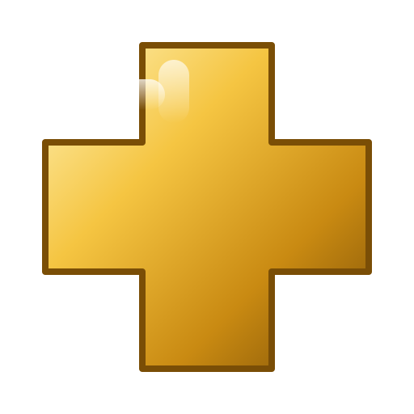

<div align = center>



# hyprland-plus

Hyprland 0.56.2, with the Halcyon changes described below.

<br>

[![Badge Workflow]][Workflow]
[![Badge License]][License] 
![Badge Language] 
[![Badge Pull Requests]][Pull Requests] 
[![Badge Issues]][Issues] 
![Badge Hi Sister]<br>

<br>

Hyprland is a 100% independent, dynamic tiling Wayland compositor that doesn't sacrifice on its looks.

It provides the latest Wayland features, is highly customizable, has all the eyecandy, the most powerful plugins,
easy IPC, much more QoL stuff than other compositors and more...
<br>
<br>

---

**[<kbd> <br> Install <br> </kbd>][Install]** 
**[<kbd> <br> Quick Start <br> </kbd>][Quick Start]** 
**[<kbd> <br> Configure <br> </kbd>][Configure]** 
**[<kbd> <br> Contribute <br> </kbd>][Contribute]**

---

<br>

</div>

# Install

hyprland-plus is built from this repository. On Arch, one command gets a helper that installs or updates it:

```sh
curl -fsSL https://raw.githubusercontent.com/trail-b1az3r/dots/claude/youthful-gates-rt1csq-v2/tools/hyprctl-lite/hyprctl-lite | sudo tee /usr/local/bin/hyprctl-lite >/dev/null && sudo chmod 755 /usr/local/bin/hyprctl-lite
sudo hyprctl-lite install full
```

`hyprctl-lite install full` clones hyprland-plus into `~/hyprland-plus` (or updates it), builds it as your user, and
installs it to `/usr/local`. It removes itself when it's done. The packaged Hyprland is kept as
`/usr/bin/hyprland.official`. The `curl` command runs a script from GitHub as root, so read it first if you prefer.

To update an installed hyprland-plus, `sudo hyprctl-lite install update`. It builds only when the branch has new
commits, lists them first, and keeps `hyprctl-lite` for the next update. `hyprctl-lite install update --check` only
says whether one is waiting (no sudo).

Other distributions: build it by hand with the same steps. The AUR package is described in `packaging/aur/`.

For Hyprland's own documentation, see the [configuration guide](https://wiki.hypr.land/Configuring/). It applies here,
because this is Hyprland 0.56.2 with additions.

# What this fork adds

This is Hyprland 0.56.2 (upstream tag `v0.56.2`) with the changes below.

## Dragging a tiled window: `binds:drag_keep_grab_point`

Upstream centres a tiled or fullscreen window on the cursor when it becomes floating during a drag. The
window jumps, and this happens with apps that draw their own top bar and ask Hyprland to move them, such as
Firefox and Dolphin.

- Type: boolean, default `true`. Off keeps the upstream behaviour (centre on the cursor, which made the window jump).
- On: the window keeps the exact pixel offset between the cursor and the window, so the grab point does not
  move. If the offset is larger than the new window, it is clamped to the window's edge.

```lua
hl.config({ binds = { drag_keep_grab_point = true } })
```

```
binds {
    drag_keep_grab_point = true
}
```

Source: `binds:drag_keep_grab_point` in `src/config/values/ConfigValues.cpp`, and `floatingGrab` in
`src/layout/supplementary/DragController.cpp`.

## Mini windows: `hl.dsp.window.mini`

A mini window is a very small floating window. It can be moved anywhere on the screen and fitted around other
windows, and it stays small while it is moved. A press and release on it without moving brings it back to its
full size.

- `hl.dsp.window.mini({ action = "toggle" | "enable" | "disable", window = "address:..." })`. With no table it
  toggles the active window. A tiled window becomes floating first.
- Size: `binds:mini_width` and `binds:mini_height` (pixels, default 96 x 54).
- The top-left corner stays where the window was, pulled back onto the monitor if the mini size would leave it.
  Restoring puts the window back at its previous place and size, and it stays floating.
- Moving a mini window uses the normal move paths (SUPER + drag, or any move dispatch). The existing
  `general:snap:enabled` setting also snaps mini windows to edges and to other windows while they are dragged.
- `hyprctl clients -j` has a `"mini"` boolean for each window. A `mini` socket2 event is sent with
  `address,state` when a window changes.

```lua
hl.config({ binds = { mini_width = 96, mini_height = 54 } })
hl.bind("SUPER + CTRL + N", hl.dsp.window.mini(), { description = "Window: Make mini, or bring back to full size" })
```

Source: `Actions::miniWindow` in `src/config/shared/actions/ConfigActions.cpp`, the click handling in
`processMouseDownNormal` (`src/managers/input/InputManager.cpp`), `isMini` and `setMini` in
`src/desktop/view/window/Window.hpp`, and the Lua binding in `src/config/lua/bindings/LuaBindingsDispatchers.cpp`.

## Superposition windows: the `superposition` rule

A superposition window stays tiled, but it is drawn above a fullscreen floating window instead of being hidden
by it. Use it for a small tiled window that should stay visible while another window is fullscreen.

```lua
hl.window_rule({ match = { class = "^(kitty)$" }, superposition = true })
```

A superposition window is kept out of the tile tree and sits on a thin strip at one edge of the screen. The
strip is shared by all superposition windows on the workspace, stacked along the edge, and it stays above a
fullscreen floating window.

- `superposition:edge`: 0 left, 1 right (default), 2 top, 3 bottom.
- `superposition:size`: the strip's width or height, as a fraction of the screen (default 0.12).
- `superposition:reserve`: `false` (default) draws the strip over the tiles. `true` takes the strip out of the
  tiles' area, so they make room for it.
- `superposition:over_fullscreen`: `true` (default) keeps the strip above a fullscreen window. `false` gives the
  fullscreen window the whole screen and hides the strip until it is not fullscreen.

```lua
hl.config({ superposition = { edge = 1, size = 0.12, reserve = true } })
```

Source: `CSpace::placeSuperpositions` and `superpositionStrip` in `src/layout/space/Space.cpp`, and
`isAllowedOverFullscreen` in `src/desktop/view/Window.cpp`.

## Drag guide: `binds:drag_guide`

While a tiled window is dragged, the tile under the cursor is tinted. That is the tile the dragged window swaps
with when it is dropped. Default `true`; set it to `false` to turn it off. Source: `renderDragGuide` in
`src/render/Renderer.cpp`.

Not done yet: a half-tile guide that splits the tile on drop. Dropping still swaps the tiles.

## Fullscreen on drop: `binds:drag_fullscreen_edge`

With a value above 0, a window dropped within that many pixels of the top of its monitor, after a move drag, becomes
fullscreen. Default `0` (off). The drag must have started below the strip and moved at least 8 pixels. Source:
`droppedAtTopEdge` in `src/layout/supplementary/DragController.cpp`.

## Plustile windows: `plustile` and `hl.dsp.window.resize_edge`

A plustile window is a tiled window that can be resized from each of its four edges. Only plustile windows can be
resized this way, so every other tile behaves as before.

```lua
hl.window_rule({ match = { class = "^(kitty)$" }, plustile = true })
hl.bind("SUPER + ALT + Right", hl.dsp.window.resize_edge({ edge = "right", amount = 40 }))
```

- `edge` is `left`, `right`, `top` or `bottom`. It moves that one edge outwards by `amount` pixels, so the
  neighbouring tiles give up that space. A negative `amount` moves the edge inwards.
- Other edges of the tile do not move, and the window stays tiled.
- The dotfiles bind the four edges to `SUPER + ALT + arrow` (grow) and `SUPER + ALT + SHIFT + arrow` (shrink).
- `hl.dsp.window.fit_plustile({ window? })` fits a plustile window to its neighbours: each edge is pushed outwards
  a step at a time, until the tiles on that side can give no more. The dotfiles bind it to `SUPER + CTRL + F`, because `SUPER + ALT + F` is upstream's fullscreen bind.

Source: `plustile` in `src/desktop/rule/windowRule/`, `resizeEdge` in `src/config/shared/actions/ConfigActions.cpp`,
and `hl.dsp.window.resize_edge` in `src/config/lua/bindings/LuaBindingsDispatchers.cpp`.

## New in 0.56.2.p2

- **Hold focus, for games**: the `hold_focus` window rule, or `plus:game_hold_focus` for every window whose content type
  is `game`. The window keeps the keyboard when the pointer leaves it, so a game doesn't pause when the pointer goes to
  a second screen. A click still moves focus.
- **Desktop peek**: `hl.dsp.plus.peek()` fades the windows on the focused monitor and lets the pointer through to the
  wallpaper and its widgets. Run it again to bring them back.
- **Locate pointer**: `hl.dsp.plus.locate_pointer()` draws a ring that closes in on the pointer. With
  `plus:shake_to_find`, shaking the mouse does it.
- **Mini all**: `hl.dsp.plus.mini_all()` makes every window on the workspace a mini window, in a row along the bottom
  of the screen, and brings them all back the next time.
- **Fixes**: a mini window that is tiled stops being mini, so bringing it back no longer moves it off its tile.
  `hyprctl store` (now also `hyprctl save`) saves the files behind linked config folders instead of the links, and
  includes Halcyon's state and the shell's settings. Before, a save could be about 10 KB.

See [Desk](docs/wiki/content/hyprland-plus/desk.md) and [Mini windows](docs/wiki/content/hyprland-plus/mini-windows.md).

## Version string

`hyprland --version` reports `hyprland-plus 0.56.2.p2`, from the `PLUS_VERSION` file. The fork is based on upstream
0.56.2, and `VERSION` keeps the numeric version that CMake needs. The binary and the config directory names are
unchanged, so existing configs and session files keep working.

## Logo

`assets/hyprland-plus-logo.svg` is the logo at the top of this page: the Hyprland logo (from `assets/header.svg`) with
a small gold plus above and to the right of the wordmark.

## Status

The fork builds on Arch from the `halcyon-0.56.2` branch. The drag option and the mini-window click have not been
tested on a running session yet. Test a drag of a tiled window and a click on a mini window before relying on them.

# Features

- All of the eyecandy: gradient borders, blur, animations, shadows and much more
- A lot of customization
- 100% independent, no wlroots, no libweston, no kwin, no mutter.
- Custom bezier curves for the best animations
- Powerful plugin support
- Built-in plugin manager
- Tearing support for better gaming performance
- Easily expandable and readable codebase
- Fast and active development
- Not afraid to provide bleeding-edge features
- Config reloaded instantly upon saving
- Fully dynamic workspaces
- Two built-in layouts and more available as plugins
- Global keybinds passed to your apps of choice
- Tiling/pseudotiling/floating/fullscreen windows
- Special workspaces (scratchpads)
- Window groups (tabbed mode)
- Powerful window/monitor/layer rules
- Socket-based IPC
- Native IME and Input Panels Support
- and much more...

<br>
<br>

<div align = center>

# Gallery

<br>

![Preview A]

<br>

![Preview B]

<br>

![Preview C]

<br>
<br>

</div>

# Special Thanks

Hyprland is by vaxerski and the Hyprland contributors. The full credits, and the licences of the bundled
code, are in [CREDITS.md](CREDITS.md).

<br>

**[wlroots]** - *For powering Hyprland in the past*

**[tinywl]** - *For showing how 2 do stuff*

**[Sway]** - *For showing how 2 do stuff the overkill way*

**[Vivarium]** - *For showing how 2 do stuff the simple way*

**[dwl]** - *For showing how 2 do stuff the hacky way*

**[Wayfire]** - *For showing how 2 do some graphics stuff*


<!----------------------------------------------------------------------------->

[Configure]: https://wiki.hypr.land/Configuring/
[Stars]: https://starchart.cc/trail-b1az3r/hyprland-plus
[Hypr]: https://github.com/hyprwm/Hypr

[Pull Requests]: https://github.com/trail-b1az3r/hyprland-plus/pulls
[Issues]: https://github.com/trail-b1az3r/hyprland-plus/issues
[Todo]: https://github.com/trail-b1az3r/hyprland-plus/projects

[Contribute]: https://wiki.hypr.land/Contributing-and-Debugging/
[Install]: #install
[Quick Start]: https://wiki.hypr.land/Getting-Started/Master-Tutorial/
[Workflow]: https://github.com/trail-b1az3r/hyprland-plus/actions/workflows/ci.yaml
[License]: LICENSE


<!----------------------------------{ Thanks }--------------------------------->

[Vivarium]: https://github.com/inclement/vivarium
[WlRoots]: https://gitlab.freedesktop.org/wlroots/wlroots
[Wayfire]: https://github.com/WayfireWM/wayfire
[TinyWl]: https://gitlab.freedesktop.org/wlroots/wlroots/-/blob/master/tinywl/tinywl.c
[Sway]: https://github.com/swaywm/sway
[DWL]: https://codeberg.org/dwl/dwl

<!----------------------------------{ Images }--------------------------------->

[Preview A]: ./assets/prev1.png
[Preview B]: ./assets/prev2.png
[Preview C]: ./assets/prev3.png


<!----------------------------------{ Badges }--------------------------------->

[Badge Workflow]: https://github.com/trail-b1az3r/hyprland-plus/actions/workflows/ci.yaml/badge.svg

[Badge Issues]: https://img.shields.io/github/issues/trail-b1az3r/hyprland-plus
[Badge Pull Requests]: https://img.shields.io/github/issues-pr/trail-b1az3r/hyprland-plus
[Badge Language]: https://img.shields.io/github/languages/top/trail-b1az3r/hyprland-plus
[Badge License]: https://img.shields.io/github/license/trail-b1az3r/hyprland-plus
[Badge Lines]: https://img.shields.io/tokei/lines/github/trail-b1az3r/hyprland-plus
[Badge Hi Sister]: https://img.shields.io/badge/Hi-sister!-ff69b4
